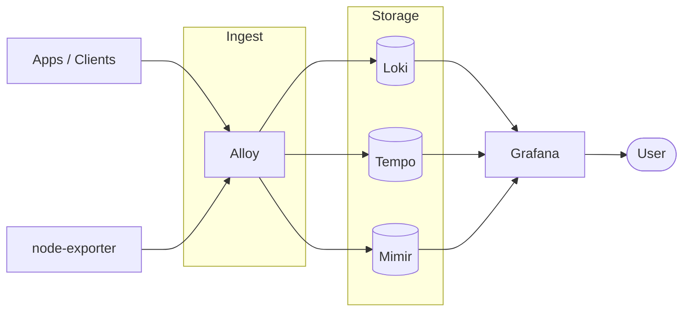

# Dokploy Monitoring Stack


Grafana + Loki + Tempo + Mimir + Alloy as a single Dokploy Compose service.

## Architecture



## Setup in Dokploy

1. **Create Service → Compose**
   - Provider: Git
   - Repository: this repo (or your fork)
   - Branch: `main`
   - Compose path: `docker-compose.yml`

   

2. **Domains** — open the **Domains** tab and add each entry below.

   | Host                    | Path                    | Service   | Container Port |
   | ----------------------- | ----------------------- | --------- | -------------- |
   | `grafana.<your-domain>` | `/`                     | `grafana` | `3000`         |
   | `alloy.<your-domain>`   | `/v1`                   | `alloy`   | `4318`         |
   | `alloy.<your-domain>`   | `/loki`                 | `alloy`   | `3500`         |
   | `alloy.<your-domain>`   | `/api/v1/metrics/write` | `alloy`   | `9090`         |

   

   Default Grafana login: `admin` / `password`


## Health Monitoring

This stack intentionally runs **without Docker `HEALTHCHECK` instructions** on its container images. All upstream images (`grafana/grafana`, `grafana/loki`, `grafana/tempo`, `grafana/mimir`, `grafana/alloy`) are distroless and contain no `curl` or `wget`, so standard `CMD curl -f ...` health checks cannot run inside them.

Instead, health is handled in three layers:

### 1. Orchestration (`docker-compose.yml`)
- Each service sets `restart: on-failure:3` so Docker restarts a crashed container.
- `grafana.depends_on` uses `condition: service_started` (not `service_healthy`) for Loki, Tempo, and Mimir, avoiding startup deadlocks when health checks can't run.

### 2. Black-box probing via Alloy (inside the stack)
Alloy scrapes each service's `/metrics` endpoint **over the Docker network** (not from inside the container). A successful scrape sets `up=1`; a failed scrape sets `up=0`. These metrics are written to Mimir and can be queried in Grafana.

```text
Alloy  ──►  grafana:3000/metrics   →  up{job="grafana"}
Alloy  ──►  loki:3100/metrics      →  up{job="loki"}
Alloy  ──►  tempo:3200/metrics     →  up{job="tempo"}
Alloy  ──►  mimir:9009/metrics     →  up{job="mimir"}
Alloy  ──►  alloy:12345/metrics    →  up{job="alloy"}
Alloy  ──►  node-exporter:9100/metrics → up{job="node-exporter"}
```

### 3. Alerting (Grafana)
Pre-written alerting rules live at `monitoring/grafana/alerting-rules.yml`. They fire when `up{job="<service>"} == 0` for more than 2 minutes.

**To activate:**
1. Log in to Grafana → **Alerting → Rules → Import** and upload `monitoring/grafana/alerting-rules.yml`.
2. Go to **Alerting → Contact points** and add a notification destination (Slack, email, webhook, etc.).
3. Create a **notification policy** that routes alerts to your contact point.

### Alternative: Traefik-level health checks
For publicly routed services (Grafana, Alloy), you can also configure Traefik backend health checks in the Dokploy UI **Domains** tab. Traefik will stop routing traffic to an unresponsive backend. This complements — but does not replace — the Alloy-based probing above.

3. **Protect Alloy with basic auth** (Traefik middleware)

   **a. Generate a hashed credential**

   ```bash
   htpasswd -nb admin 'password'
   # → admin:$apr1$G3T3XOqn$6JGifVcvveyWFg7gYWZjH0
   ```

   **b. Create the middleware** in Dokploy: go to **Dokploy → Settings → Traefik** (or the **Traefik** tab on the server) and open the dynamic config file editor. Add a new file `middlewares.yml` (or append to an existing one):

   ```yaml
   http:
     middlewares:
       alloy-auth:
         basicAuth:
           # admin / password
           users:
             - "admin:$apr1$G3T3XOqn$6JGifVcvveyWFg7gYWZjH0"
   ```

   **c. Attach it to each Alloy domain.** In the service's **Domains** tab, edit each `alloy.<your-domain>` row:

   ```
   alloy-auth@file
   ```

## Commands

```bash
# bash (curl)
./examples/sh/send-test-log.sh "hello from devops"
./examples/sh/send-test-metric.sh 42
./examples/sh/send-test-trace.sh

# node
cd examples/node && pnpm start
```


